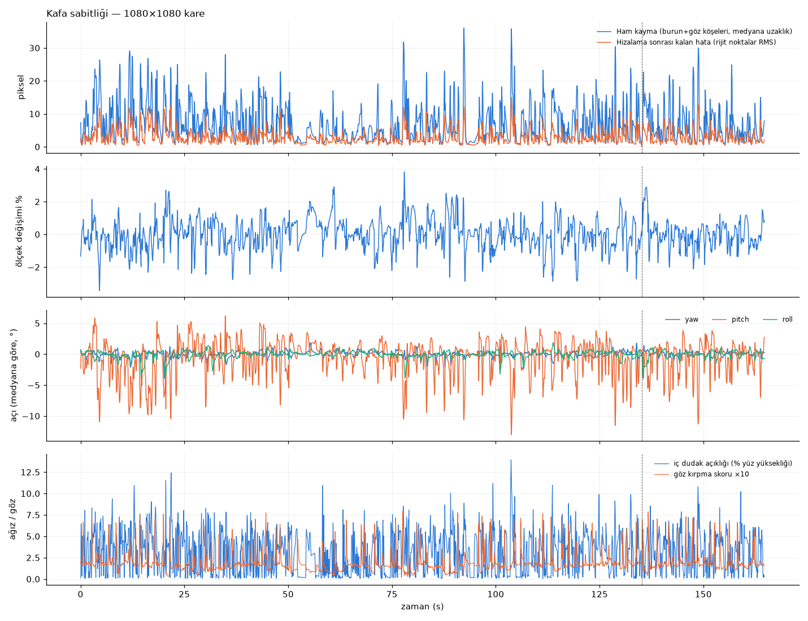
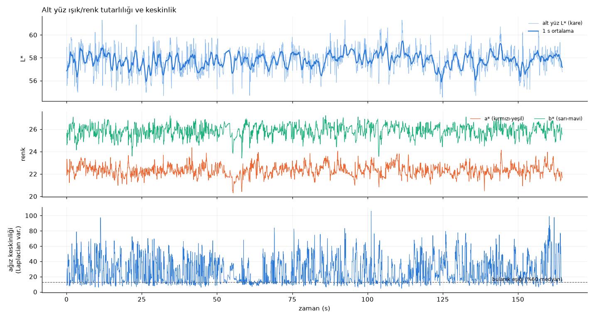

# Viseme tabanlı lip sync – `reference.mp4` uygunluk raporu

**Kısa sonuç:** Video bu yöntem için **teknik olarak uygun**. Işık, renk, keskinlik ve kadraj iyi, ağzın önünde engel yok, parça bindirme dikişsiz çalışıyor. Zayıf yönleri iki tane. Birincisi, konuşmacı ağzını **az ve tekdüze** açıyor: A/E/I neredeyse aynı görünüyor. İkincisi, kafa konuşurken **öne-arkaya sallanıyor** ve videoda yeterince uzun bir sessiz bölüm yok: en uzun kapalı ağız 2,0 s, içinde göz kırpma yok. Sonuç küçük pencerede inandırıcı, tam ekranda ise mekanik duruyor.

| Kullanım | Puan |
|---|---|
| Küçük sohbet penceresi (~300 px) | **7 / 10** |
| Tam ekran | **4 / 10** |

En önemli çıktı: [`out/comparison.mp4`](out/comparison.mp4) (gerçek | sentez, ilk 15 s, sesli). Alt yüz yakın planı: [`out/comparison_zoom.mp4`](out/comparison_zoom.mp4).

---

## 1. Teknik özet (ffprobe)

| Özellik | Değer |
|---|---|
| Çözünürlük | 1080 × 1080 (kare) |
| FPS | 25 (sabit) |
| Süre | 164,76 s (4119 kare) |
| Video codec | H.264 High, yuv420p |
| Video bitrate | 1636 kbps (0,056 bit/piksel, 1080p için düşük-orta) |
| Ses | AAC-LC, 48 kHz, stereo, 189 kbps |
| Kadraj | Siyah arka plan, göğüsten yukarı, önden. Yüz yüksekliği ≈ 420 px, göz dış köşeleri arası ≈ 221 px |

Konuşma içeriği bilinçli hazırlanmış bir okuma metni. İçinde serbest cümleler, "baba, bebek, pamuk…" gibi dudak kapanması gerektiren kelimeler, "ma me mı mi…", "fa fe…", "va ve…" hece dizileri, sayılar ve "ş" ağırlıklı cümleler var. Bu, viseme kapsaması için iyi bir senaryo. Transkript: [`out/transcript.txt`](out/transcript.txt).

## 2. Kafa sabitliği



| Ölçüm | Ortalama | p95 | Maks. |
|---|---|---|---|
| Yüzün bulunamadığı kare | 0 / 4119 (%0) | | |
| Ham kayma: burun ucu + 4 göz köşesi, medyana uzaklık (px) | 7,2 | 18,3 | 36,1 |
| Burun ucu kayması (px) | 10,2 | 28,4 | 60,0 |
| Burun ucunun gezdiği aralık (px) | yatay 36, **dikey 97** | | |
| Kareden kareye titreşim (px) | 1,7 | 6,2 | 14,3 |
| Ölçek değişimi | −%3,4 … +%3,8 (std %0,9) | | |
| Yaw (sağa-sola), medyandan sapma (°) | 0,3 | 0,9 | 3,9 |
| **Pitch (öne-arkaya eğme), medyandan sapma (°)** | **2,0** | **6,2** | **13,0** |
| Roll (yana yatma), medyandan sapma (°) | 0,4 | 1,3 | 4,0 |
| **Hizalama sonrası kalan hata**, rijit noktalar RMS (px) | **2,9** | 7,5 | 15,0 |
| Hizalama sonrası kalan hata, dikiş bölgesi: burun altı + yanak kenarı (px) | 3,8 | 9,8 | 20,5 |

**Değerlendirme:** Yaw ve roll çok iyi. Ancak kişi konuşurken başını sürekli yukarı-aşağı sallıyor. Pitch'in göz merkezinin dikey konumuyla korelasyonu 0,88, yani bu gerçek bir kafa hareketi, landmark hatası değil. Kafa **tek başına yeterince sabit değil**. Bu yüzden her kareye referans kareye (3380. kare, t = 135,2 s) benzerlik dönüşümü (öteleme + dönme + ölçek; `estimateAffinePartial2D`, ağız ve çeneden etkilenmeyen 20 nokta) uyguladım.

Düzlem içi hareket tamamen düzeliyor. Kalan ~3 px'lik hatanın kaynağı başın öne-arkaya eğilmesi (pitch), bu da 2B dönüşümle giderilemez: burun ile çene arasındaki perspektif değişiyor. Seçim adımı parça karelerini en düşük hizalama hatalı karelerden aldığı için (0,4–1,9 px) bu etki parçalara taşınmıyor.

## 3. Konuşma zamanlaması

- faster-whisper **medium** (CPU, int8, `language="tr"`, `word_timestamps=True`). Sonuç: 312 kelime, 1695 harf. Transkripsiyon çok iyi. Hece dizilerinde ("pa pe pı…") birkaç kayma var.
- Her kelimenin süresi harflerine bölündü (ünlü ağırlığı 1,6, ünsüz 1,0). "ğ" önceki ünlüyü uzattı. Kelime sınırları ses enerjisine göre kırpıldı. 80 ms'den uzun boşluklar SIL olarak işaretlendi. KG harfleri için komşu ünlü `coart_vowel` sütununa yazıldı.
- **Doğruluk testi:** PBM'de dudak mutlaka kapanır, bu yüzden PBM'yi ölçüt olarak kullandım:

| Zamanlama | PBM etiketi tam o karede kapanma ile eşleşme | ±1 kare | ±2 kare |
|---|---|---|---|
| Whisper → harf bölme (ham) | %34 | %45 | %64 |
| + 40 ms öne kaydırma | %36 | %58 | |
| + PBM'yi en yakın gerçek kapanmaya oturtma (±3 kare) | %74 | | |

  Ağız sesten ortalama ~1 kare önce şekil alıyor. Harf bölme kare düzeyinde kaba kalıyor. Gerçek üründe zamanlama TTS'ten gelecek, bu yüzden analizde görüntüyle iyileştirilmiş zaman çizelgesini kullandım ([`scripts/s03b_refine.py`](scripts/s03b_refine.py)). Ham çizelge: `out/visemes_raw.csv`. **Bu nedenle comparison.mp4'teki senkron, TTS kullanılan gerçek durumdan biraz daha iyimser.**
- Çıktılar: `out/words.csv`, `out/letters.csv`, `out/letters_refined.csv`, `out/visemes.csv`.

## 4–5. Ağız ölçümleri ve viseme kapsaması

Kare bazlı ölçümler [`out/frame_metrics.csv`](out/frame_metrics.csv) dosyasında. Sütunlar:
- iç dudak açıklığı / yüz yüksekliği,
- ağız genişliği / göz dış köşeleri arası mesafe,
- yuvarlaklık = genişlik / dış dudak yüksekliği,
- çene açıklığı = burun ucu–çene / alın–burun ucu,
- MediaPipe blendshape'leri, keskinlik, bloklanma, diş oranı, alt yüz Lab ölçümleri.

Dağılım sütunu, viseme içi IQR'nin tüm videonun IQR'sine oranı. Değer küçükse viseme kendi içinde tutarlı ve diğerlerinden ayırt edilebilir demektir.

| Viseme | Kare | Geçiş | Süre (s) | Dağılım | Medyan açıklık | Medyan genişlik | Medyan yuvarlaklık | Kalite notu |
|---|---|---|---|---|---|---|---|---|
| SIL | 1190 | 107 | 47,6 | 0,25* | 0,002* | 0,56 | 3,42 | **İyi.** Ağız kapalı kareler bol. *Yalnızca ≥0,4 s duraklamalardaki kapalı kareler alındı. Kişi kısa duraklamalarda ağzı aralık tutuyor. |
| PBM | 406 | 163 | 16,2 | 0,78 | 0,004 | 0,56 | 2,91 | **İyi.** Dudaklar net kapanıyor, bol örnek var. |
| FV | 84 | 44 | 3,4 | 0,75 | 0,030 | 0,57 | 2,45 | **Orta-zayıf.** Az örnek var. Alt dudağın üst dişlere değdiği karakteristik şekil yalnızca "vı/vi" hecelerinde net. Seçilenler daha çok "aralık + diş" görüntüsünde. |
| DNT | 459 | 318 | 18,4 | 0,93 | 0,036 | 0,57 | 2,35 | **Zayıf ayırt edicilik.** Görsel olarak nötr bir ağız. Dil ucu görünmüyor. |
| SZ | 114 | 76 | 4,6 | 0,87 | 0,043 | 0,60 | 2,43 | **Orta.** Dişler birbirine yakın ve görünür, dudak hafif yayvan. |
| SH | 102 | 71 | 4,1 | 0,82 | 0,040 | 0,56 | 2,08 | **Orta.** Bir örnekte (#2) dudak öne çıkması net, diğerleri belirsiz. |
| KG | 246 | 171 | 9,8 | 0,93 | 0,037 | 0,57 | 2,27 | **Beklendiği gibi şekilsiz.** Komşu ünlüyü kullanmak doğru karar. |
| A | 353 | 160 | 14,1 | 0,76 | 0,042 | 0,57 | 2,30 | **Zayıf.** Ağız az açılıyor, A'nın %90'lık açıklığı bile E'nin medyanı kadar. Çene hareketi küçük. |
| E | 338 | 155 | 13,5 | 0,77 | 0,048 | 0,60 | 2,30 | **Orta.** En geniş ve açık ünlü bu konuşmacıda E. |
| I | 459 | 190 | 18,4 | 0,78 | 0,038 | 0,58 | 2,42 | **Orta-zayıf.** A ve E'den zor ayırt ediliyor. |
| O | 161 | 75 | 6,4 | 0,88 | 0,017 | 0,51 | 2,06 | **İyi.** Yuvarlak ve dar ağız belirgin. |
| U | 207 | 98 | 8,3 | 0,67 | 0,027 | 0,52 | 2,12 | **Orta.** Ölçüler ayırt edici, ama medyana göre seçilen #1 karesi yeterince yuvarlak değil (bkz. §8). #3 ("dokuz") daha iyi. |

**Eksik veya zayıf viseme'ler:** A/E/I ünlüleri birbirine çok yakın. FV'nin net örnekleri az. DNT ve KG görsel olarak nötr. Hiçbir viseme tamamen eksik değil. Tüm viseme'ler en az 44 ayrı geçişte görülüyor.

**Seçim:** Her viseme için 3 kare seçildi. Ölçüt: medyana yakınlık + Laplacian keskinliği + göz açık + kafa referansa yakın + segmentin ortası, ve her kare farklı bir geçişten. Kontak tabakaları:
- tümü: [`out/contact_all.png`](out/contact_all.png)
- viseme başına: `out/contact_<VISEME>.png`
- seçim tablosu: `out/selected_frames.csv`

**Gözle kontrol:** Kontak tabakalarında PBM, O, SIL ve SH#2 doğru ve net. A, E ve I sütunları yan yana konduğunda neredeyse aynı: dişler hafif görünüyor, ağız az aralık. Bu, medyan ölçütünün "ortalama" kareleri seçmesinden ve harf zamanlamasının gürültüsünden kaynaklanıyor. Videoda daha belirgin kareler de var: A ve E için açıklığın %90'lık değeri 0,063–0,072, maksimum 0,139.

**Parçalar:** `out/patches/<VISEME>_<n>.png`, toplam 36 adet RGBA parça. Referans kareye hizalı, kenarlar 18 px feather. Maske; çene hattı, burun altı ve yanak bölgesini kapsıyor. Kaynak karenin çenesi daha aşağıdaysa maske onu da içine alıyor ve boyun geçişi için 20 px aşağı uzatılıyor. Ofsetler `out/patches/patches.json` dosyasında.

## 6. Boşta taban döngüsü

- **En uzun kesintisiz kapalı ağız: 2,00 s.** Seçilen döngü: 1306–1355. kareler (52,24–54,24 s). Bu, "farklı sesleri deneyelim" bölümünden önceki duraklama.
  - Kafa hareketi: pencere içinde maks. 2,5 px, titreşim p95 0,3 px. Çok sabit.
  - **Göz kırpması yok.** Videoda ağız kapalıyken göz kırpılan 2 s'lik bir bölüm yok.
- **Döngü sıçraması:** Son kare ile ilk kare arasındaki piksel farkı (MAE) 2,80, ardışık karelerin medyanı ise 0,25. Göz merkezi 2,2 px kayıyor. Düz döngüde kafa her 2 s'de belirgin bir küçük "zıplama" yapacak. Çözüm olarak ileri-geri oynatılan **ping-pong** sürümü üretildi: `idle/idle_loop_pingpong.mp4`. Bu sürümde sıçrama yok ve hareket çok yavaş olduğu için yön dönüşü fark edilmiyor. Manifest ve sentez bu sürümü kullanıyor.
- Alternatif: göz kırpması içeren en iyi pencere 1586–1635. kareler (63,4 s). Kafa hareketi 3,8 px, ağız %64 kapalı. Bu tabanla her zaman SIL parçası bindirmek gerekir.
- Çıktılar: `out/idle/idle_loop.mp4`, `out/idle/idle_loop_pingpong.mp4`, `out/idle/frames/idle_000..049.jpg`, `out/idle/idle.json`.

## 7. Kalite kontrolleri



| Kontrol | Sonuç | Değerlendirme |
|---|---|---|
| Alt yüz parlaklığı L* | ort. 57,8, std 0,93, 1 s ortalamada toplam aralık 3,6 | **Çok tutarlı.** Başla sonun farkı 0,2. Küçük dalgalanmalar baş sallamayla bağlantılı (pitch korelasyonu −0,37). |
| Alt yüz rengi | a* std 0,48, b* std 0,52. Medyana göre ΔE p50 0,9, p95 2,2 | Renk kayması yok. Beyaz dengesi sabit. |
| Parça ↔ taban uyumu (feather halkası) | ΔE ortalama: medyan 0,65, maks. 1,81 (E_2). Piksel bazlı medyan ΔE 1,8 | **Fark edilmez** (ΔE < 2). Renk düzeltmesine gerek yok. 1080 çözünürlükte, ölçeklemeden bakınca bile dikiş görünmüyor. |
| Bulanık kare oranı | Ham: %21,6 (<%60 medyan). **İçerik düzeltilmiş: %8,9; ağır bulanık: %3,4** | Kapalı ağızda kenar az olduğu için ham oran yanıltıcı. Gerçek bulanıklık hareket bulanıklığı: bulanık karelerde kafa titreşimi 3,25 px, diğerlerinde 1,58 px. |
| Sıkıştırma bozukluğu | Bloklanma oranı medyan 1,08, p95 1,27. Hafif (>1,3) %2,6, belirgin (>1,5) %0 | Ağız bölgesinde blok yok. 1,6 Mbps 300 px için yeterli. Tam ekranda cilt dokusu biraz "yağlı boya" gibi yumuşak. |
| Dişler | Açık ağız karelerinin medyanında iç dudak alanının %36'sı diş | **Net görünüyor.** Üst dişler ve dişler arası boşluk keskin. Kontak tabakalarında temiz. |
| Dil | Ağız boşluğunun koyu oranı medyan %13 | **Neredeyse hiç görünmüyor.** Ağız az açıldığı için dil ucu (l/d/t/n) seçilemiyor. |
| Engel (el, mikrofon, saç) | Yok | Genel kare taraması ve kontak tabakalarında ağzın önünde hiçbir şey yok. Landmark %100 bulundu. |

## 8. Deneme çıktısı: comparison.mp4 gözlemleri

İlk 15 s üretildi. Taban: ping-pong idle. Bindirme: her viseme'in #1 parçası. Geçişler 60 ms crossfade. KG komşu ünlünün parçasını kullanıyor. 40 ms'den kısa PBM/FV'ler en yakın kareye zorlanıyor. Çıktılar: `out/comparison.mp4` (yan yana, 540 px), `out/comparison_zoom.mp4` (alt yüz yakın planı), `out/synth_only.mp4` (1080 px), `out/synth_check/*.jpg`.

Gözlemlerimin kaynağı: karşılaştırma videosundan çıkardığım ardışık kare şeritleri ve 1080 çözünürlükte ölçeklenmemiş kırpmalar.

**İyi olanlar**
- **Dikiş yok.** Burun altı, yanaklar ve çene hattı tabanla kesintisiz birleşiyor. Renk ve parlaklık farkı yok. Çene açılınca çift çene ya da kopuk çene hattı oluşmuyor.
- Kapanma (PBM) ve yuvarlak ünlüler (O) anlaşılır. Sessizlikte ağız temiz kapanıyor.
- 540 px'de yan yana izlerken sentez "gerçek bir kişi konuşuyor" etkisini büyük ölçüde veriyor.

**Mekanik ya da bozuk görünenler**
1. **Ağız genliği düşük ve tekdüze.** A/E/I parçaları birbirine çok benzediği için konuşma "mırıldanma" gibi duruyor. Gerçek videoda her hecede şekil biraz farklıyken sentezde aynı 3–4 görüntü dönüyor. Örneğin 4,30–4,34 s'de gerçek ağız belirgin şekilde yuvarlanıyor, sentezdeki U ise neredeyse E gibi.
2. **Kafa ve gövde donuk.** Sentezde baş 2 s'lik neredeyse sabit bir döngüde duruyor, gerçekte ise konuşmayla birlikte sallanıyor. Göz kırpma da yok. Tam ekranda en çok bu göze batıyor.
3. **Aynı karenin tekrarı.** Her viseme için hep aynı kare kullanıldığından, uzun ünlülerde ağız "donmuş fotoğraf" gibi kalıyor. 25 fps'te 60 ms crossfade yalnızca 1–2 kare sürüyor, bu yüzden hızlı konuşmada geçişler hafif "kesik" görünüyor.
4. **Senkron.** Etiketler görüntüyle düzeltildiği halde ±1–2 karelik kaymalar var. Ham Whisper zamanlamasıyla bu kaymalar daha belirgin olurdu. TTS'ten gelen kesin zamanlamada bu sorun büyük ölçüde kalkar.
5. Dil hiç görünmüyor. l/n/t/d sesleri görsel olarak boş kalıyor.

## 9. Uygunluk puanı

**a) Küçük sohbet penceresi (~300 px): 7/10.**
- Lehine: Bu boyutta düşük bitrate, kalan ~3 px hizalama hatası ve dil eksikliği görünmez. Bindirme dikişsiz ve renk uyumu kusursuz. PBM, O/U ve SIL doğru okunuyor, dudak senkronu inandırıcı.
- Aleyhine: Donuk kafa ve tekdüze ağız küçük pencerede de hissediliyor. Göz kırpma eksikliği de birkaç saniye sonra fark ediliyor.

**b) Tam ekran: 4/10.**
- Lehine: Çözünürlük ve ışık yeterli. Dikiş 1080'de bile görünmüyor.
- Aleyhine: Tam ekranda yöntemin sınırları açığa çıkıyor:
  - A/E/I ayırt edilemiyor, aynı kareler tekrar ediyor.
  - Dil yok.
  - Baş ve gözler hareketsiz. 2 s'lik idle döngüsü fazla kısa.
  - 1,6 Mbps sıkıştırma cilt dokusunu yumuşatmış.

  Sonuç "canlı video" değil, "hareketli fotoğraf" izlenimi veriyor.

## 10. Öneriler

### Bu videoyla hemen yapılabilecekler
1. **Daha belirgin prototipler:** A ve E için medyan yerine %70–80'lik açıklığa yakın kareler, O ve U için en dar ve yuvarlak kareler seçilsin. Konuşma daha net okunur. Kontak tabakalarında bu kareler var: U#3 "dokuz", E#3 "üzere", SH#2 "konuşuyorum".
2. **Varyant döndürme:** Her viseme'in 3 parçası sırayla ya da rastgele kullanılsın. Ünlünün süresi uzunsa iki varyant arasında yavaşça geçilsin.
3. **Göz kırpması katmanı:** 63,4 s'deki göz kırpmasından üst yüz parçaları (göz kapakları) çıkarılıp tabana 3–6 s'de bir rastgele bindirilsin. Hizalama altyapısı aynen kullanılabilir.
4. Tarayıcıda **50–60 fps** çizim yapılsın: crossfade 60 ms'de 3–4 kareye yayılır. Gerekirse yalnızca dudak kapanmaları için crossfade 40 ms'ye indirilsin.

### Yeni çekim yapılacaksa
- **Kafa:** Başı sabit tutun. Kameraya bakarken başı sallamamak için sırtı ve başı destekleyen bir sandalye kullanın. Metin kamera hizasında bir prompter'da olsun ki göz ve baş aşağı-yukarı gitmesin.
- **Sessiz bölümler:** Çekimin başında ve sonunda **10'ar saniye**, bölümler arasında da 3–4 kez **5 saniye** ağız kapalı, rahat, doğal göz kırpmalı bekleme yapın. Bunlar idle döngüsü olacak. Birkaç tanesinde hafif gülümseme ve "dinliyor" ifadesi de olsun.
- **Artikülasyon:** Normalden biraz daha belirgin konuşun, A'da çeneyi rahatça açın. Avatarlar için "abartısız ama net" ağız idealdir.
- **Okunacaklar** (her biri 2–3 kez):
  - Uzatılmış ünlüler, her biri ~1 s tutularak: "aaa – eee – ııı – iii – ooo – ööö – uuu – üüü".
  - Ünlü + ünsüz dizileri: "ama – eme – ımı – imi – omo – umu", "afa – efe – ifi – ofo – ufu", "ava – eve – ivi", "asa – ese – isi – osu", "aşa – eşe – işi – oşo", "aça – eçe – içi", "ala – ele – ili – olo – ulu" (dil ucu görünsün), "ana – ene – ini", "aka – eke – iki – oko".
  - Bütün viseme'leri içeren doğal cümleler:
    - "Bahar sabahı pembe papatyalar bahçede açmıştı."
    - "Fırtınalı havada vapur volta atıp Fenerbahçe'ye vardı."
    - "Şu çocuk şeker çiçekli şemsiyesini sevdi."
    - "Mutlu bulutlar uzun ufukta usulca yürüdü."
    - "Öğle güneşi gölgeli köşkün önünü ısıttı."
    - "Lale ile Nil, ilginç bir dilin incelikleri üzerine konuştu."
    - "Doktor, oda kapısında sakin sakin bekledi."
  - Mevcut "baba, bebek, pamuk…" ve sayı bölümlerini koruyun, iyi işliyor.
- **Işık:** Mevcut ışık çok iyi: yumuşak, önden, siyah fon. Aynen koruyun. Pozlamayı, beyaz dengesini ve odağı **manuel kilitleyin**. Ağız içine hafif dolgu ışığı ekleyin ki dişler ve dil daha okunur olsun.
- **Kadraj ve kayıt:**
  - Tam ekran hedefleniyorsa yüzü kadrajın daha büyük bir kısmına yerleştirin (yüz yüksekliği 1080'lik karenin ~%55–60'ı) ya da 4K çekin.
  - **50 fps** ve 1/100 s enstantane kullanın: hareket bulanıklığı azalır.
  - Bitrate'i yüksek tutun: ≥ 10 Mbps H.264 ya da kameranın en yüksek kalitesi. Sonradan sıkıştırılacaksa bile ham kayıt yüksek kaliteli olsun.

### Uzun vadede
Tam ekran ve gerçekçilik hedefi önemliyse, bu videoyu "kimlik" verisi olarak kullanan sinirsel yöntemlerin (ses → ağız; ör. Wav2Lip, MuseTalk, LatentSync tarzı modeller) sonucu bu viseme yaklaşımını kalitede belirgin şekilde geçer. Viseme yaklaşımı ise küçük pencere, sıfır gecikme ve tarayıcıda çalışma için ucuz ve sağlam bir çözüm.

## 11. Tarayıcı oynatıcısı için manifest

[`out/manifest.json`](out/manifest.json) şunları içerir:
- `frame_size`, `fps`, `reference` (referans kare ve görüntüsü), `crossfade_ms = 60`, `feather_px`
- `visemes.<V>.patches[]`: `file`, `x`, `y`, `w`, `h` (referans koordinatında), kaynak kare, zaman ve kelime. `SIL.draw = "base"` (taban ağzı zaten kapalı). `KG.coarticulate` kuralı.
- `idle.frames[]`: her idle karesinin dosyası ve `from_ref`. `from_ref`, canvas `setTransform(a,b,c,d,e,f)` için hazır 6 sayıdır ve parçayı referans koordinatından o idle karesine taşır. Ayrıca `playback: "pingpong"` ve `playback_order`.

Çizim: `drawImage(idleFrame)` → `setTransform(...from_ref)` → her aktif parça için `globalAlpha = ağırlık; drawImage(patch, x, y)`. Doğru crossfade için iki viseme'i ayrı offscreen canvas'lara tabanla birlikte çizip ağırlıklı karıştırın. Python karşılığı: [`scripts/compositor.py`](scripts/compositor.py).

## Ek: Kurulum ve yeniden çalıştırma

```powershell
winget install --id Python.Python.3.12 --scope user
winget install --id Gyan.FFmpeg --scope user        # ffmpeg/ffprobe
cd viseme_analysis
py -3.12 -m venv .venv    # veya: <Python312>\python.exe -m venv .venv
.venv\Scripts\pip install opencv-python mediapipe faster-whisper numpy pandas pillow matplotlib scipy
# model: models\face_landmarker.task  (storage.googleapis.com/mediapipe-models/face_landmarker/...)
cd scripts
..\.venv\Scripts\python s01_probe.py
..\.venv\Scripts\python s02_landmarks.py      # ~3 dk
..\.venv\Scripts\python s03_transcribe.py medium
..\.venv\Scripts\python s03b_refine.py
..\.venv\Scripts\python s04_metrics.py
..\.venv\Scripts\python s05_select.py
..\.venv\Scripts\python s06_idle.py
..\.venv\Scripts\python s07_quality.py
..\.venv\Scripts\python s08_synth.py 15 0     # süre, başlangıç (s)
..\.venv\Scripts\python s09_manifest.py
```

Notlar:
- faster-whisper ile kurulu PyAV sürümü uyumsuz, bu yüzden ses numpy dizisi olarak veriliyor.
- `mediapipe 1.x`'te eski `solutions` API'si yok. Tasks API (`FaceLandmarker`) kullanıldı.
